# walgo-mcp

[](https://modelcontextprotocol.io/)
[](LICENSE)

> Drive [walgo](https://web.walgo.xyz) — apps, games, art, sites on Walrus + Sui — from any AI coding agent.

walgo-mcp is the bridge between an MCP-capable agent (Claude Code, Cursor, Codex, Continue, Gemini CLI, …) and a paired walgo browser tab. The browser tab holds the user's Sui wallet; the MCP server is a typed proxy. Every chain transaction (deploy, link SuiNS, extend storage) is signed in the browser tab — the server never sees keys.

## Quick start

The hosted MCP at `https://mcp.walgo.xyz/mcp` is the canonical endpoint. One-line install for Claude Code:

```bash
curl -fsSL https://mcp.walgo.xyz/install.sh | bash
```

For other agent hosts, see the per-client snippets at <https://mcp.walgo.xyz/>.

After configuring the MCP, ask your agent:

> *call walgo_pair*

It returns a deep link plus an 8-digit code. Open the link in the wallet-connected tab on `https://web.walgo.xyz` and your agent can drive deploys end-to-end.

## Architecture

```mermaid
%%{init: {'theme':'base','themeVariables':{'fontFamily':'JetBrains Mono, monospace','primaryColor':'#11161d','primaryTextColor':'#e6f1ff','primaryBorderColor':'#4da2ff66','lineColor':'#4da2ff','tertiaryColor':'#0a0f14','background':'#0a0f14'}}}%%
flowchart LR
    A["🤖 Your agent<br/><sub>Claude · Cursor · Codex · Gemini</sub>"]
    B["🔌 walgo-mcp<br/><sub>mcp.walgo.xyz</sub>"]
    C["🪟 walgo browser tab<br/><sub>web.walgo.xyz · wallet</sub>"]
    D["🌐 Walrus + Sui<br/><sub>&lt;name&gt;.wal.app</sub>"]

    A -->|"Streamable HTTP"| B
    B -.->|"wss · pairing code"| C
    C -->|"wallet signs every tx"| D

    classDef agent fill:#1a2b3f,stroke:#4da2ff,stroke-width:2px,color:#e6f1ff
    classDef bridge fill:#0d3556,stroke:#4da2ff,stroke-width:3px,color:#ffffff
    classDef wallet fill:#1a2b3f,stroke:#34d399,stroke-width:2px,color:#e6f1ff
    classDef chain fill:#1a2b3f,stroke:#a78bfa,stroke-width:2px,color:#e6f1ff
    class A agent
    class B bridge
    class C wallet
    class D chain
```



### Pairing flow

```mermaid
%%{init: {'theme':'base','themeVariables':{'fontFamily':'JetBrains Mono, monospace','primaryColor':'#11161d','primaryTextColor':'#e6f1ff','primaryBorderColor':'#4da2ff66','lineColor':'#4da2ff','actorBkg':'#11161d','actorBorder':'#4da2ff','actorTextColor':'#e6f1ff','signalColor':'#4da2ff','signalTextColor':'#e6f1ff','noteBkgColor':'#0d3556','noteTextColor':'#e6f1ff','noteBorderColor':'#4da2ff','sequenceNumberColor':'#0a0f14','background':'#0a0f14'}}}%%
sequenceDiagram
    autonumber
    participant U as User
    participant A as Agent
    participant M as walgo-mcp
    participant B as Browser tab

    A->>M: walgo_pair
    M-->>A: { code, deepLink }
    A->>U: paste deepLink
    U->>B: open https://web.walgo.xyz/pair/&lt;code&gt;
    B->>M: wss /pair?code=&lt;code&gt;
    M-->>M: validate code in CoordinatorDO
    M->>B: paired ✓
    Note over A,B: bridge open — agent tools route to browser
    A->>M: walgo_deploy
    M->>B: forward request via wss
    B-->>U: wallet prompt → sign
    U-->>B: signed tx
    B->>M: result
    M-->>A: { objectId, digest }
```

Two transports share most of the codebase:

| Transport | Where | Use |
|---|---|---|
| **Streamable HTTP** | Cloudflare Worker (`worker/`) | Hosted public endpoint at `https://mcp.walgo.xyz/mcp` — recommended for end users |
| **stdio** | Node binary (`src/`) | Local development, offline use, or self-hosted local install |

The wire protocol between server and paired browser is in `src/protocol.ts` (and mirrored to `worker/src/protocol.ts` and walgo-web's `src/lib/mcp/protocol.ts`). All three are kept in sync.

## Tools

15 tools, all routed through the paired browser:

| Group | Tools |
|---|---|
| Pairing | `walgo_pair`, `walgo_status` |
| Draft files | `walgo_init_template`, `walgo_clear_draft`, `walgo_load_site`, `walgo_list_files`, `walgo_read_file`, `walgo_write_file`, `walgo_delete_file` |
| Deploy / sites | `walgo_deploy`, `walgo_list_sites` |
| SuiNS | `walgo_list_suins`, `walgo_resolve_suins`, `walgo_link_suins` |
| Storage | `walgo_epoch_info`, `walgo_extend_epochs` |

Each tool's input schema is exposed via standard MCP `tools/list`. The skill at <https://mcp.walgo.xyz/skill.md> documents recipes (build new site, edit existing, link SuiNS, etc.) that agents follow.

## Local development

```bash
npm install
npm test          # vitest, ~16 specs
npm run build     # tsc — produces dist/
node dist/index.js
```

Run the worker locally (Cloudflare Workers + Durable Objects):

```bash
cd worker
npm install
npm run dev       # wrangler dev on http://localhost:8788
npm run deploy    # wrangler deploy (needs CF auth)
```

## Limitations

- The hosted Worker uses 8-digit pairing codes with a 5-minute TTL and per-IP rate limiting on `/pair`. Brute-forcing one code in that window is statistically infeasible but not impossible — don't pair on shared/untrusted networks.
- Sessions are ephemeral. If a Durable Object hibernates mid-session, the user re-pairs (no UX loss; cheap).
- The browser must run on a wallet-supported origin. Mixed-content rules: `https://web.walgo.xyz` → `wss://mcp.walgo.xyz` works in all modern browsers; `ws://localhost` from `https://` works in Chrome/Edge but not Firefox.

## License

[MIT](LICENSE).
